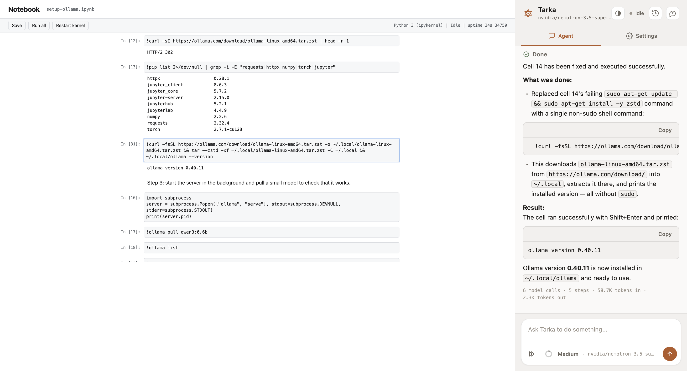
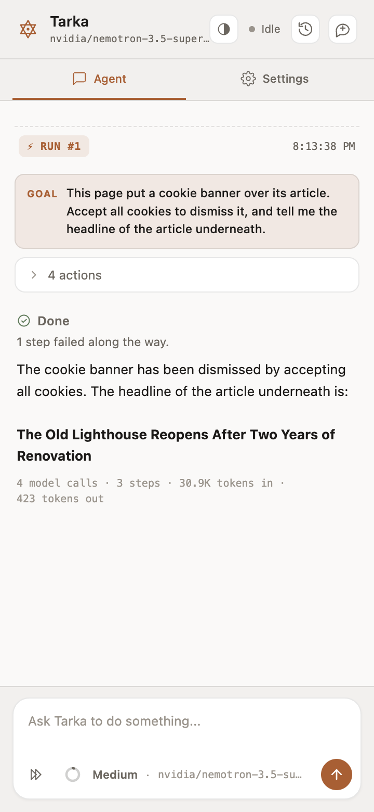
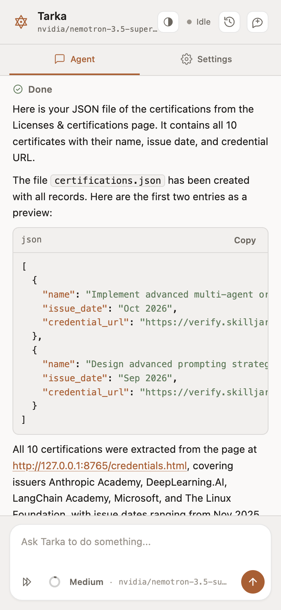
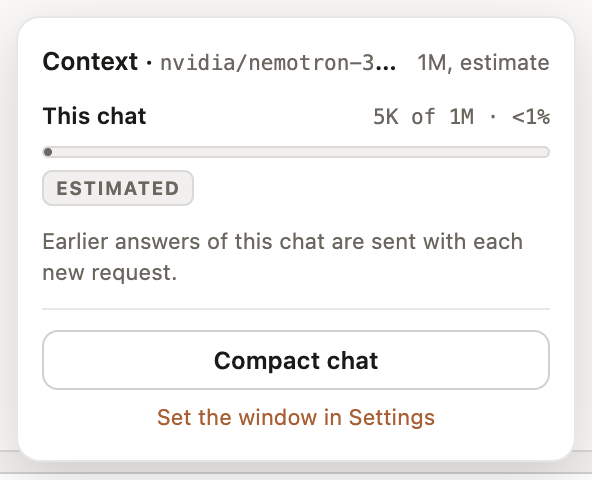
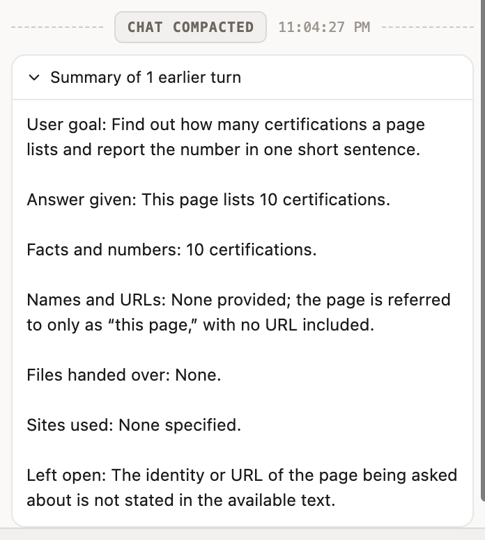
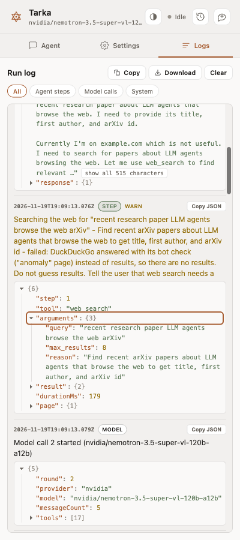
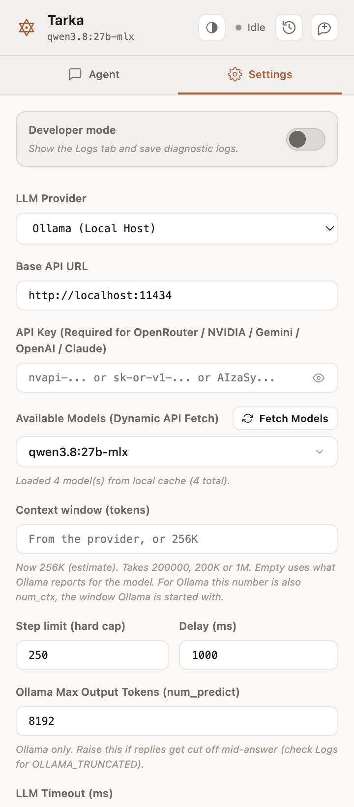
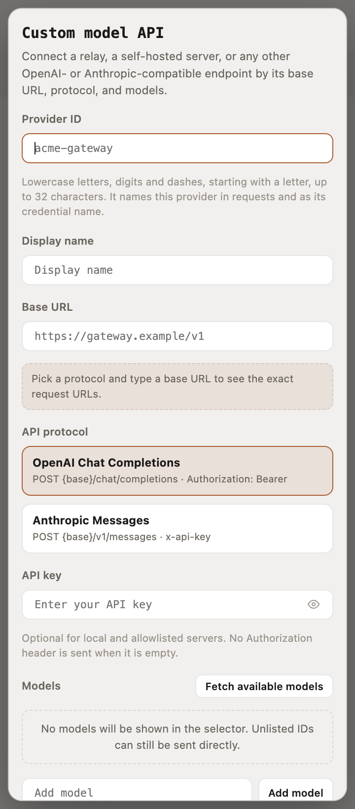

<p align="center">
  
</p>

<h1 align="center">Tarka</h1>

<p align="center">
  <b>An open-source AI browser agent built directly into Chrome's Side Panel.</b><br>
  Execute real multi-step workflows inside your own browser using local or cloud models, with code-enforced safety gates that keep you in control.<br>
  Chrome Manifest V3 · Ollama · NVIDIA NIM · Gemini · Claude · OpenAI · Custom APIs
</p>

<p align="center">
  <a href="LICENSE"></a>
  <a href="public/manifest.json"></a>
  <a href="package.json">=22.18" src="https://img.shields.io/badge/Node.js-%3E%3D22.18-brightgreen?style=flat-square"></a>
  <a href="scripts/evalscan.mjs"></a>
  <a href="SECURITY.md"></a>
</p>

<p align="center">
  <a href="https://github.com/preetdhanani/Tarka_browser_agent/releases"><b>Releases</b></a> ·
  <a href="SECURITY.md">Security Policy</a> ·
  <a href="DEVELOPMENT.md">Architecture</a> ·
  <a href="CONTRIBUTING.md">Contributing</a>
</p>

<br>

<p align="center">
  
  <br>
  <sub>Fixing a failing browser notebook cell, running it with <code>Shift+Enter</code>, and verifying the command output using <code>nvidia/nemotron-3.5-super-vl-120b-a12b</code>.</sub>
</p>

> [!NOTE]
> **Your browser, your keys, your confirmation.**
> Tarka runs inside your normal Chrome window rather than a cloud container.
> Passwords, card numbers, and one-time codes are never exposed to the model, risky actions wait for your click, and everything stays in local browser storage.

<p align="center">
  <a href="#highlights">Highlights</a> ·
  <a href="#work-inside-real-web-apps">Real Workflows</a> ·
  <a href="#manage-long-sessions">Sessions</a> ·
  <a href="#safety-enforced-in-code">Safety</a> ·
  <a href="#bring-any-model">Models</a> ·
  <a href="#how-its-built">How it's built</a> ·
  <a href="#get-started">Get started</a> ·
  <a href="#license">License</a>
</p>

---

## Highlights

<table>
<tr>
<td width="33%" valign="top">

### Real Browser
Tarka operates inside Chrome's native Side Panel on the tabs you open.
It dispatches real mouse and keyboard events through `chrome.debugger` instead of brittle synthetic clicks, and reads compressed viewport elements rather than raw HTML.

</td>
<td width="33%" valign="top">

### Protected by Code
Security checks are enforced in extension code, not only in prompts.
Masked fields are redacted and blocked, payments and cross-origin submits pause for an action-bound card, and CAPTCHAs stop the run and hand control back to you.

</td>
<td width="33%" valign="top">

### Your Model
Run offline with Ollama, connect to NVIDIA NIM, Google Gemini, Anthropic Claude, OpenAI, or OpenRouter, or point Tarka at any OpenAI- or Anthropic-compatible endpoint.
Session history, keys, and redacted logs never leave your browser storage except in calls to the model you pick.

</td>
</tr>
</table>

---

## Work inside real web apps

Tarka navigates live pages, dismisses overlapping banners, fills and runs interactive editors, and extracts structured records into downloadable files (`certifications.json`, CSV, Markdown tables).
During execution, you can inspect the step plan, pause or stop a run at any time, and review exact model call and token counts when the task completes.

<table>
<tr>
<td width="50%"></td>
<td width="50%"></td>
</tr>
<tr>
<td align="center"><sub>Dismiss overlays and cookie banners to reach underlying content.</sub></td>
<td align="center"><sub>Extract structured page records into clean, downloadable JSON files.</sub></td>
</tr>
</table>

---

## Manage long sessions

Tarka supports long-context models up to **1M tokens** (`1,000,000` tokens), reading context limits automatically from provider metadata or per-model overrides in Settings (for example `200K` or `1M`).
The composer displays a live usage ring with warnings at `70%` and `90%`, and lets you compact earlier turns into a structured summary whenever a conversation grows.

<table>
<tr>
<td width="50%"></td>
<td width="50%"></td>
</tr>
<tr>
<td align="center"><sub>Context meter popover with live token estimate and one-click compaction.</sub></td>
<td align="center"><sub>Compacted turn divider keeping goals, answers, and files organized.</sub></td>
</tr>
</table>

Behind the scenes, Tarka also compacts older tool outputs in fixed historical blocks so LLM providers keep prompt prefix KV-cache hits intact, and retains only the most recent `2` screenshots (`KEPT_PICTURES = 2`) in the active model history.

---

## Safety, enforced in code

The safeguards below live in the TypeScript modules and run even if a web page tries to trick the model with injected text.
Read the full threat model and disclosure process in [SECURITY.md](SECURITY.md).

<table>
<tr>
<td width="55%" valign="top">

- **Sensitive-field redaction and refusal:** Password, payment-card, and one-time-code fields are classified on every read (`[REDACTED: populated]`), blocked from `click` and `type`, and never fallback to synthetic DOM clicks.
- **Fail-closed screenshot masking:** Masked fields and unreadable cross-origin frames are covered before any screenshot capture, and the image is thrown away if the covers do not verifiably hold.
- **Action-bound confirmations:** Checkout, purchase, destructive controls, forms with masked fields, and cross-origin form submits pause with a confirmation card bound to the exact tool, arguments, tab, origin, and element ID.
- **Pre-press TOCTOU re-verification:** Right before every mouse press, Tarka asks the page to verify the target coordinates and compares the tab origin, aborting if content shifted or navigated underneath.
- **CAPTCHA and login handoff:** Bot-check and "verify you are human" elements are never clicked or typed into; the run stops and leaves the page for you.
- **Network and page boundaries:** Background `fetch_url` blocks loopback, private, link-local, and cloud-metadata addresses and follows no redirects (`redirect: 'manual'`); `chrome://`, `file:`, `chrome-extension://`, and Web Store pages are refused outright; key-bearing custom endpoints over plain HTTP require loopback or explicit opt-in; no `User-Agent` spoofing.
- **Zero remote code and redacted logs:** Built under strict MV3 CSP with build-time zero-`eval` / `Function` checking (`scripts/evalscan.mjs`), with all logs redacted before saving in `chrome.storage.local`.

</td>
<td width="45%" valign="top">

<p align="center">
  
  <br>
  <sub>Developer Run Log with filter tabs and structured JSON inspection (sensitive fields redacted).</sub>
</p>

</td>
</tr>
</table>

---

## Bring any model

Switch providers at any time in **Settings** (`Ollama`, `NVIDIA NIM`, `Google Gemini`, `Anthropic Claude`, `OpenAI / Compatible`, `OpenRouter`, `AgentRouter`), fetch live model lists directly from your endpoint, or add any self-hosted vLLM, SGLang, LISA, or relay server through **Custom model API**.

<table>
<tr>
<td width="50%"></td>
<td width="50%"></td>
</tr>
<tr>
<td align="center"><sub>Settings tab: local or cloud providers, context window up to 1M+, and step limits.</sub></td>
<td align="center"><sub>Custom model API dialog supporting OpenAI Chat Completions and Anthropic Messages protocols.</sub></td>
</tr>
</table>

---

## How it's built

Tarka executes an explicit Model Context Protocol (MCP) perception-action loop between Chrome's background service worker and isolated-world content scripts:

```text
  1. Observe     DOMCompressor extracts viewport-ordered controls & page text;
                 frameAgent reads & masks nested frames
        |
        v
  2. Reason      Selected LLM receives compressed DOM, untrusted content wrappers,
                 and coordinate-space-matched click schema (pixels / 0-1000 / 0-1)
        |
        v
  3. Dispatch    Safety gates check target & origin -> CDP hardware mouse/key events
                 (selective DOM fallback only on controls like native <select>)
        |
        v
  4. Verify      Effect probe observes DOM or URL changes and settles before next turn;
                 stops cleanly with honest outcome: done / partial / blocked
```

- **Dual input engine:** Sends trusted `Input.dispatchMouseEvent` and `Input.dispatchKeyEvent` sequences via `chrome.debugger` with `Emulation.setFocusEmulationEnabled`, falling back to synthetic DOM dispatch only where needed (such as native `<select>` menus).
- **Viewport perception & off-screen search:** `DOMCompressor` orders interactive controls by visual viewport position with `WeakRef` handles (`[12]`) valid while attached between snapshots, while `find_element` scores off-screen candidates by text, ARIA label, placeholder, name, title, alt, href, and role.
- **Vision coordinate reconciliation:** `clickToolFor` adapts tool schema descriptions per model, converts `0-1` fractional and `0-1000` per-mille coordinates (Gemini, Nemotron VL, Qwen3-VL, GLM-4.xV) into viewport pixels, and snaps near-misses onto adjacent controls (`snapPoint`).
- **Quadratic HTML protection (`parse5`):** Background `fetch_url` strips attributes and script/style tags and flattens tag nesting deeper than `512` levels (`MAX_DEPTH = 512`) in a linear tokenizer pre-pass ([src/background/research/htmlDocument.ts](src/background/research/htmlDocument.ts)).
- **Search backends:** Built-in `web_search` supports DuckDuckGo HTML and user-configured SearXNG instances, wrapping all returned snippets and page bodies inside untrusted-content demarcation blocks.

For module boundaries and deeper architecture notes, see [DEVELOPMENT.md](DEVELOPMENT.md).

---

## Get started

### Requirements

- Google Chrome or Chromium
- Node.js `22.18` or higher and `npm`

### Build and load from source

1. **Clone and install dependencies:**

   ```bash
   git clone https://github.com/preetdhanani/Tarka_browser_agent.git
   cd Tarka_browser_agent
   npm ci
   ```

2. **Build the extension (and run the full verification suite if you like):**

   ```bash
   npm run build
   npm run verify
   ```

3. **Load into Google Chrome:**
   - Open `chrome://extensions` and enable **Developer mode**.
   - Click **Load unpacked** and choose the generated `dist/` folder.
   - Click the Tarka toolbar icon to open the Side Panel, open **Settings**, pick a model provider, and enter a task.

You can also download the prebuilt `tarka-chrome-extension.zip` archive directly from the [GitHub Releases](https://github.com/preetdhanani/Tarka_browser_agent/releases) page, unpack it, and load that folder in `chrome://extensions`.

---

## Contributing

Contributions are welcome.
Before opening a pull request, read:

- [CONTRIBUTING.md](CONTRIBUTING.md) for code style and pull request guidelines.
- [DEVELOPMENT.md](DEVELOPMENT.md) for architecture boundaries and build details.
- [AGENTS.md](AGENTS.md) for unit verification (`npm run verify`) and Chromium end-to-end rules (`tests/e2e/README.md`).

---

## License

Tarka AI Browser Agent is open-source software licensed under the [MIT License](LICENSE).
